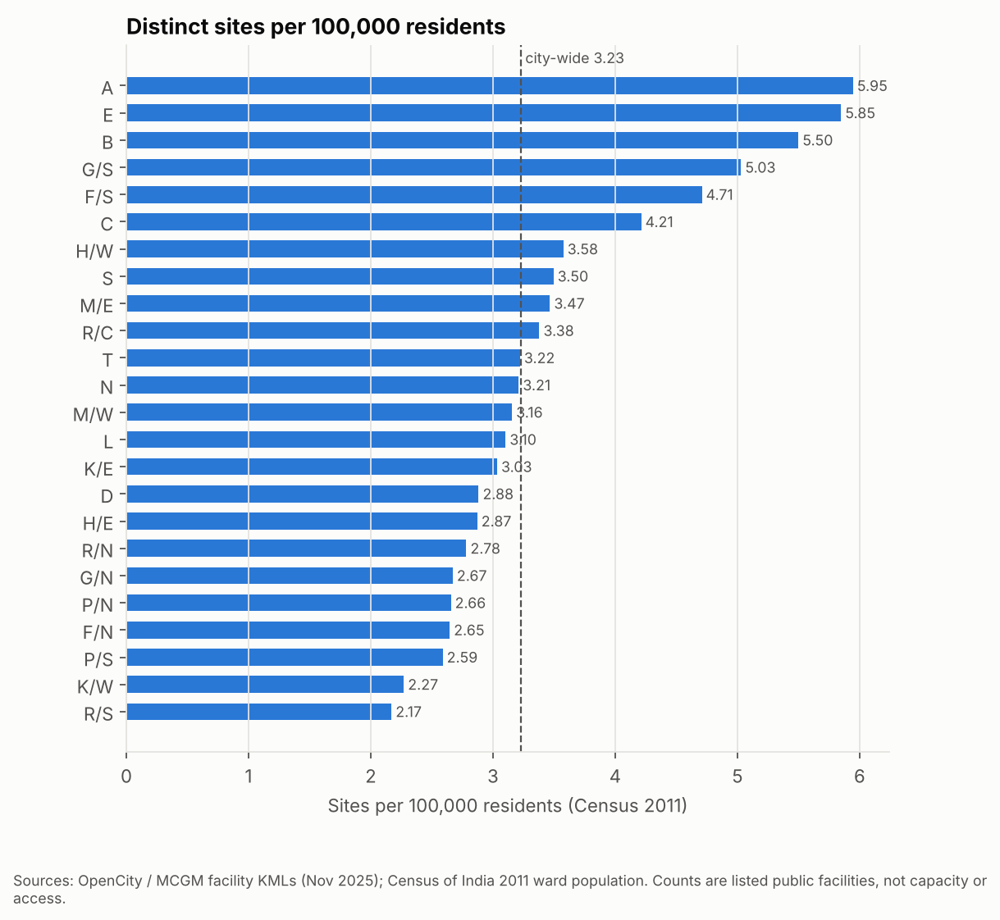
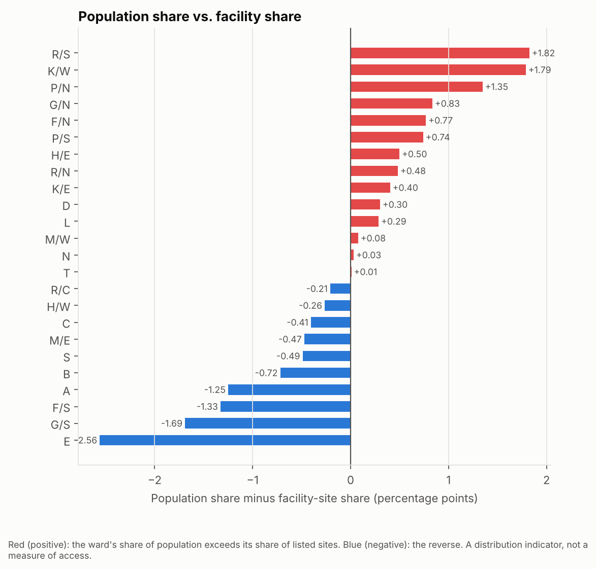
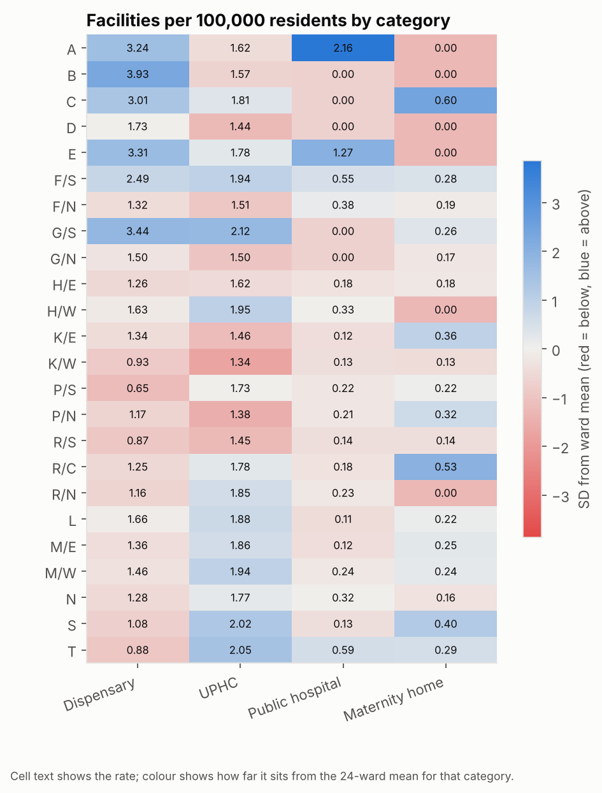
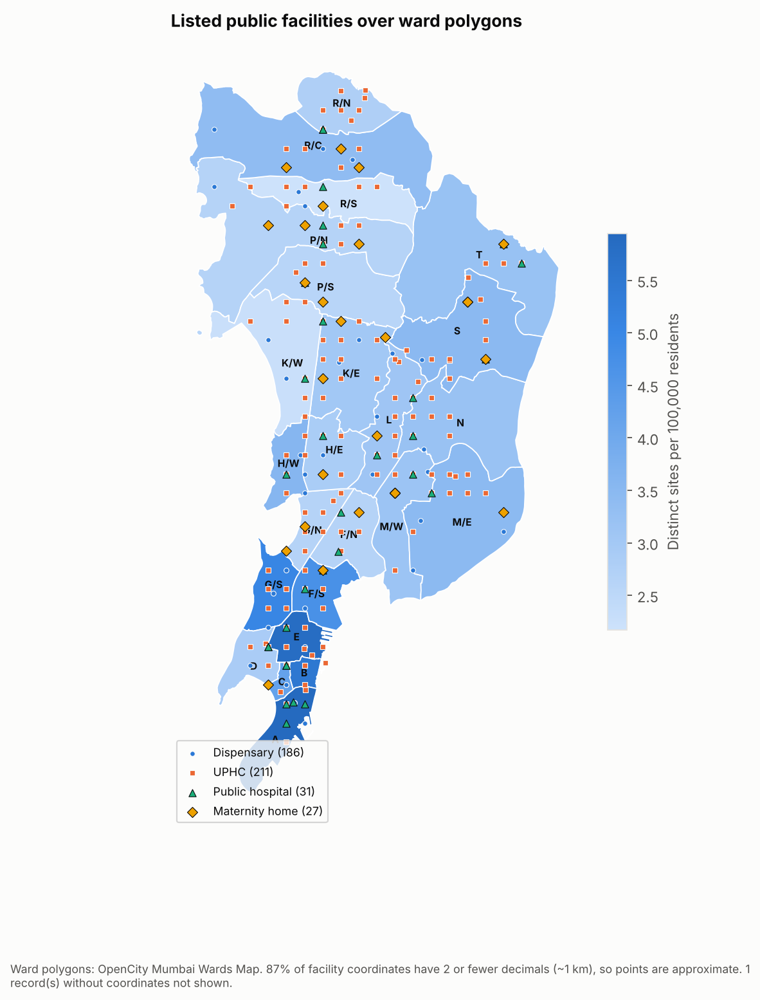
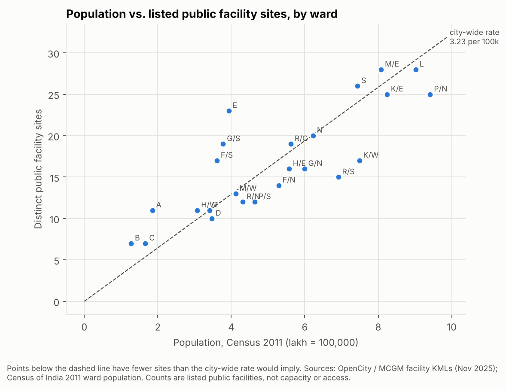
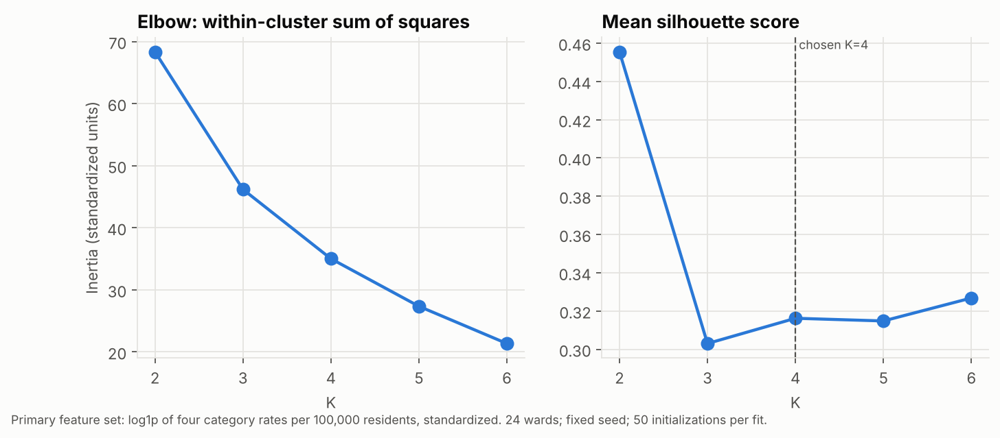
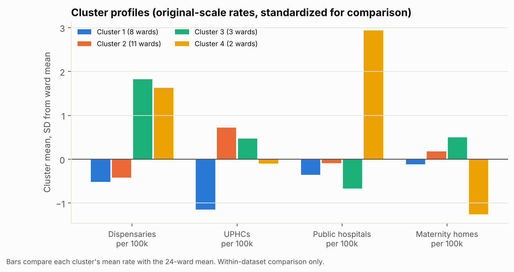
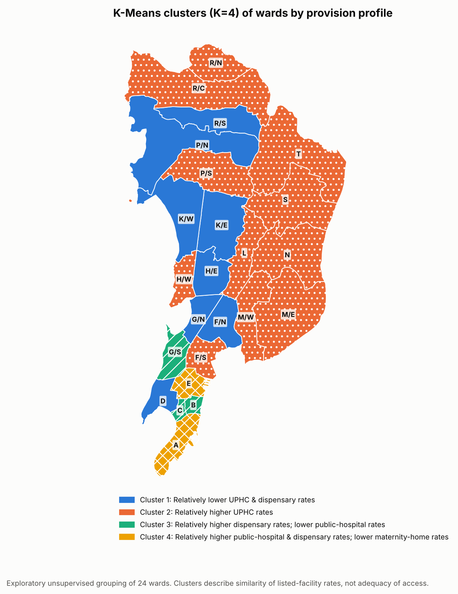

# Healthcare Facility Provision Across Mumbai's 24 Wards
### Data engineering, geospatial analysis and K-Means clustering of listed public health facilities

*Academic data-analytics project. Every number in this report is generated from the pipeline outputs
(`src/build_report.py`). Generated 2026-10-19.*

## 1. Executive summary

* The MCGM facility layers list **456 public facility records** (dispensaries
  186, UPHCs 211, public hospitals
  31, maternity homes 28) at
  **402 distinct sites**. Against a Census 2011 population of 12,442,373,
  that is **3.23 sites per 100,000 residents** city-wide.
* Ward rates range from 2.17 (R/S) to
  5.95 (A) per 100k, a 2.74× spread.
  The island-city wards (A–G/N) have 4.02 sites per 100k against 2.97 in the suburban wards.
* Facility counts track population closely (Pearson r = 0.829), but more populous
  wards have *lower* rates (Spearman ρ = -0.572).
* 14 of 24 wards hold a larger share of population than of listed sites. The largest gaps are
  R/S (+1.82 pp), K/W (+1.79 pp), P/N (+1.35 pp).
* K-Means (K = 4, silhouette 0.316) finds 4 provision profiles. The
  clustering is exploratory: silhouettes for K = 3–6 are nearly flat, and the grouping depends on the feature set.
* These are **distribution indicators for listed public facilities**. They do not measure capacity, staffing,
  quality, travel time or private provision, and do not show that any ward is underserved.

## 2. Problem, questions and scope

The project asks whether listed public healthcare facilities are distributed in proportion to population across
Greater Mumbai's 24 administrative wards, and which wards share similar provision profiles. It answers seven
questions (Section 7) from verified data only.

## 3. Data sources, dates and coverage

| Dataset | Source | Reference date | Use |
|---|---|---|---|
| Dispensaries, UPHCs, public hospitals, maternity homes (KML) | OpenCity, original source MCGM | resources created 2025-11-25 | Facility records, coordinates, source ward |
| Mumbai Hospitals List (CSV) | OpenCity / MCGM | undated | Reconciliation only (no coordinates) |
| Mumbai Wards Map (KML) | OpenCity | undated | Ward polygons, area, spatial checks |
| Ward-wise Census 2011 + Primary Census Abstract | OpenCity / Census of India | 2011 | Population denominator |

**Date mismatch.** Facilities date from about 2025 and population from 2011. The PRD's 2023 ward population was not
supplied. Mumbai's population has grown since 2011, unevenly across wards, so the per-capita rates here are
indicative only. Swapping in a newer population table needs one file change (`src/population.py`).

## 4. Preprocessing, deduplication and ward assignment

* **Ward standardization:** source values such as `KE` and `K/E` map to canonical ids by a structural rule that is
  verified against the 24 polygon names. Every record mapped.
* **Coordinates:** parsed from KML points; 1 record without coordinates.
  Most coordinates are rounded to 2 decimals (≈ 1 km), so tolerances are precision-aware.
* **Distinct sites:** records merge only when ward, type-stripped name and coordinates (within 300 m plus rounding
  error) all agree. 54 pairs matched, mostly a dispensary and a UPHC at the
  same site, giving 402 sites. No exact or within-layer duplicates were found.
* **Ward assignment:** the source `Ward` attribute is authoritative. A point-in-polygon check agrees for
  387 records and is within rounding error for
  44
  more. 24 records are
  flagged for manual review.
* **Hospitals CSV:** 18 public hospitals in the CSV
  are absent from the KML layers: 13 state/central institutions (ESIS, railway, defence and others)
  and 5 BMC-listed facilities. Counts here cover the MCGM facility layers only.

Details: `docs/data_quality_report.md`.

## 5. Data quality and integration results

The ward table is driven by the 24-ward master list, so no ward can be dropped by a join. Automated checks confirm
that ward totals equal the facility-master totals for every category and for distinct sites, that population and
facility shares each sum to 100%, and that the census aggregation reproduces the Primary Census Abstract exactly.

## 6. Indicator definitions

| Indicator | Formula | Undefined when |
|---|---|---|
| Sites per 100k | distinct sites / population × 100,000 | population missing or ≤ 0 |
| Population per site | population / distinct sites | zero sites |
| Category rate per 100k | category records / population × 100,000 | population missing or ≤ 0 |
| Category share of sites | category records / distinct sites × 100 (can sum > 100%: co-located sites) | zero sites |
| Population share | ward population / total × 100 | — |
| Facility share | ward sites / total sites × 100 | — |
| Share gap | population share − facility share (pp; positive = relatively fewer listed sites) | — |

Undefined values stay empty (NaN); they are never filled with zero. All 24 wards have at least one site and a
positive population, so no indicator is undefined in the real data. The edge cases are covered by unit tests.

| Ward | Pop. 2011 | Disp. | UPHC | Hosp. | Mat. | Sites | Sites/100k | Pop./site | Gap (pp) | Cluster |
|---|---|---|---|---|---|---|---|---|---|---|
| A | 185,014 | 6 | 3 | 4 | 0 | 11 | 5.95 | 16,819 | -1.25 | 4 |
| B | 127,290 | 5 | 2 | 0 | 0 | 7 | 5.50 | 18,184 | -0.72 | 3 |
| C | 166,161 | 5 | 3 | 0 | 1 | 7 | 4.21 | 23,737 | -0.41 | 3 |
| D | 346,866 | 6 | 5 | 0 | 0 | 10 | 2.88 | 34,687 | 0.30 | 1 |
| E | 393,286 | 13 | 7 | 5 | 0 | 23 | 5.85 | 17,099 | -2.56 | 4 |
| F/S | 360,972 | 9 | 7 | 2 | 1 | 17 | 4.71 | 21,234 | -1.33 | 2 |
| F/N | 529,034 | 7 | 8 | 2 | 1 | 14 | 2.65 | 37,788 | 0.77 | 1 |
| G/S | 377,749 | 13 | 8 | 0 | 1 | 19 | 5.03 | 19,882 | -1.69 | 3 |
| G/N | 599,039 | 9 | 9 | 0 | 1 | 16 | 2.67 | 37,440 | 0.83 | 1 |
| H/E | 557,239 | 7 | 9 | 1 | 1 | 16 | 2.87 | 34,827 | 0.50 | 1 |
| H/W | 307,581 | 5 | 6 | 1 | 0 | 11 | 3.58 | 27,962 | -0.26 | 2 |
| K/E | 823,885 | 11 | 12 | 1 | 3 | 25 | 3.03 | 32,955 | 0.40 | 1 |
| K/W | 748,688 | 7 | 10 | 1 | 1 | 17 | 2.27 | 44,040 | 1.79 | 1 |
| P/S | 463,507 | 3 | 8 | 1 | 1 | 12 | 2.59 | 38,626 | 0.74 | 2 |
| P/N | 941,366 | 11 | 13 | 2 | 3 | 25 | 2.66 | 37,655 | 1.35 | 1 |
| R/S | 691,229 | 6 | 10 | 1 | 1 | 15 | 2.17 | 46,082 | 1.82 | 1 |
| R/C | 562,162 | 7 | 10 | 1 | 3 | 19 | 3.38 | 29,587 | -0.21 | 2 |
| R/N | 431,368 | 5 | 8 | 1 | 0 | 12 | 2.78 | 35,947 | 0.48 | 2 |
| L | 902,225 | 15 | 17 | 1 | 2 | 28 | 3.10 | 32,222 | 0.29 | 2 |
| M/E | 807,720 | 11 | 15 | 1 | 2 | 28 | 3.47 | 28,847 | -0.47 | 2 |
| M/W | 411,893 | 6 | 8 | 1 | 1 | 13 | 3.16 | 31,684 | 0.08 | 2 |
| N | 622,853 | 8 | 11 | 2 | 1 | 20 | 3.21 | 31,143 | 0.03 | 2 |
| S | 743,783 | 8 | 15 | 1 | 3 | 26 | 3.50 | 28,607 | -0.49 | 2 |
| T | 341,463 | 3 | 7 | 2 | 1 | 11 | 3.22 | 31,042 | 0.01 | 2 |

## 7. Exploratory findings



*Figure 1. Distinct sites per 100,000 residents (Census 2011).*


**Q1 – Highest and lowest counts.** Most sites: L (28), M/E (28), S (26).
Fewest: D (10), B (7), C (7).
Raw counts mostly follow population (r = 0.829), so ranking by count favours large wards.

**Q2 – Lowest per-capita provision.** Lowest rates: R/S (2.17), K/W (2.27), P/S (2.59), F/N (2.65)
per 100k. Highest: A (5.95), E (5.85), B (5.50).
*Limitation:* the denominators are 2011 populations. Fast-growing suburban wards are likely under-counted, which
would make their true rates lower still.



*Figure 2. Population share minus facility-site share, percentage points.*


**Q3 – Population share vs facility share.** 14 wards have a positive gap. The largest:
R/S (+1.82 pp), K/W (+1.79 pp), P/N (+1.35 pp), G/N (+0.83 pp). The most
negative: E (-2.56 pp), G/S (-1.69 pp), F/S (-1.33 pp).

**Q4 – Facility mix.** Public hospitals are concentrated: E (5) and
A (4) hold 9 of
31 hospital records, which include the medical-college hospitals. Wards with no listed public
hospital: B, C, D, G/S, G/N. Wards with no listed maternity home: A, B, D, E, H/W, R/N. Dispensary rates are
highest in the island city (B 3.93, G/S 3.44, E 3.31, A 3.24).
UPHC rates vary much less across wards (1.34–2.12 per 100k).
IQR outliers are listed in `outputs/tables/eda_iqr_outliers.csv`.



*Figure 3. Category rates per 100k; colour = SD from the 24-ward mean (red below, blue above).*


**Q5 – Geographic pattern.** Higher rates cluster in the southern island city, which is the historic core with the
major teaching hospitals. Lower rates appear in the large western and eastern suburbs. Because most coordinates are
rounded to about 1 km, the map is valid at ward scale, not street scale.



*Figure 4. Facility locations over ward polygons shaded by sites per 100k.*




*Figure 5. Ward population vs distinct sites; dashed line = city-wide rate.*


## 8. Machine learning: K-Means clustering

**Objective.** Group wards by similarity of provision profile. No independently defined target (such as measured
access or outcomes) exists, so supervised learning is not justified. A label derived from these same rates would be
circular.

**Features.** Rates per 100k for the four categories: dispensaries, UPHCs, public hospitals and maternity homes.
Their pairwise Spearman correlations are weak (|ρ| ≤ 0.29), so they are not redundant. The overall site rate and
population-per-site are excluded because they are functions of these rates, and population is excluded because it
already sits in every denominator. log1p was applied before z-scoring to damp the A/E hospital outliers.
Configuration: StandardScaler → KMeans, n_init = 50, max_iter = 500,
random_state = 42, scikit-learn 1.9.1.

**Choosing K.** Every candidate K was fitted and checked for silhouette, inertia, cluster sizes and stability
(30 seeds, 100 × 80% subsamples, 100 × 5% multiplicative noise; adjusted Rand index against the full-data solution):

| k | inertia | silhouette | cluster_sizes | status | seed_ari_min | subsample80_ari_mean | subsample80_ari_p10 | noise5pct_ari_mean |
|---|---|---|---|---|---|---|---|---|
| 2 | 68.343 | 0.456 | [22, 2] | ok | 1.000 | 0.599 | -0.029 | 0.963 |
| 3 | 46.184 | 0.303 | [13, 9, 2] | ok | 1.000 | 0.685 | 0.369 | 0.673 |
| 4 | 35.015 | 0.316 | [11, 8, 3, 2] | ok | 0.888 | 0.727 | 0.337 | 0.640 |
| 5 | 27.351 | 0.315 | [10, 7, 3, 2, 2] | ok | 0.781 | 0.752 | 0.512 | 0.630 |
| 6 | 21.353 | 0.327 | [8, 7, 3, 2, 2, 2] | ok | 0.747 | 0.778 | 0.559 | 0.662 |



*Figure 6. Elbow and silhouette diagnostics.*


K = 2 has the highest silhouette (0.456), but it only separates two outlier wards (A, E) from the
rest. It is also unstable under subsampling: its 10th-percentile ARI is -0.03, because
the two-ward cluster disappears whenever A or E is left out. There is no clear elbow, and silhouettes for K = 3–6
fall within 0.024 of each other. **K = 4 was
chosen as a documented compromise:**
1. It keeps the A/E split.
2. It splits the other 22 wards into the same three groups that an independent K = 3 run on those 22 wards produces.
3. It has a single two-ward cluster, against two at K = 5 and three at K = 6.
4. Its stability is moderate: seed-ARI minimum 0.89, mean subsample ARI
   0.73, mean noise ARI 0.64.

The choice involves judgement and is not an objective optimum. The K = 2 labels are exported alongside the K = 4
labels.

**Cluster profiles.** Clusters are numbered by ascending mean sites per 100k. Profile wording compares each
cluster with the 24-ward mean (±0.5 SD) and is relative to this dataset only.

| Cluster | n | Wards | Profile | Silh. | Disp./100k | UPHC/100k | Hosp./100k | Mat./100k | Sites/100k |
|---|---|---|---|---|---|---|---|---|---|
| 1 | 8 | D, F/N, G/N, H/E, K/E, K/W, P/N, R/S | Relatively lower UPHC & dispensary rates | 0.43 | 1.26 | 1.46 | 0.15 | 0.19 | 2.65 |
| 2 | 11 | F/S, H/W, P/S, R/C, R/N, L, M/E, M/W, N, S, T | Relatively higher UPHC rates | 0.26 | 1.35 | 1.89 | 0.28 | 0.24 | 3.34 |
| 3 | 3 | B, C, G/S | Relatively higher dispensary rates; lower public-hospital rates | 0.00 | 3.46 | 1.83 | 0.00 | 0.29 | 4.91 |
| 4 | 2 | A, E | Relatively higher public-hospital & dispensary rates; lower maternity-home rates | 0.64 | 3.27 | 1.70 | 1.72 | 0.00 | 5.90 |



*Figure 7. Cluster mean of each feature in SD units from the ward mean.*




*Figure 8. Ward-to-cluster map.*


**Sensitivity to the feature set.** ARI against the final clustering at K = 4:
primary_log_category_rates 1.00; raw_category_rates 0.89; primary_vs_secondary_care 0.24; overall_rate_and_density 0.37. Removing the log
transform changes little. Coarser feature sets (primary vs secondary care; overall rate + density) produce
substantially different groupings. The clusters reflect *which* provision dimensions are emphasised, not a unique
natural partition.

**Limitations.** There are only 24 observations; cluster 3 has a mean silhouette near zero, so its wards sit between
clusters; and the model has no external validation. Internal metrics say nothing about predictive or clinical validity.

## 9. Power BI report

Direct authoring is blocked because Power BI Desktop runs on Windows only and this project was built on macOS. No
PBIX was created or tested. Import-ready tables (`powerbi/data/`), the relationship design, DAX measures, a
three-page layout and step-by-step setup are in `powerbi/powerbi_spec.md`. `powerbi/data/expected_kpis.json` holds
the KPI values the finished report must reproduce.

## 10. Findings and recommendations for further investigation

Wards that combine a low site rate with a positive share gap: **F/N, K/W, P/S, R/S**. Cluster 1 (lower dispensary and
UPHC rates) contains D, F/N, G/N, H/E, K/E, K/W, P/N, R/S. These wards merit further investigation. That does not mean they are
underserved: their absolute site counts are often high, and residents may use facilities in neighbouring wards or
private providers.

Data needed to judge access:
1. Current (2023+) ward population estimates.
2. Beds, OPD capacity and staffing per facility.
3. Travel time on the road and transit network rather than ward membership.
4. Private and state/central facilities, starting with the 18 public hospitals found only in the CSV.
5. Utilisation and health-outcome data.
6. Exact facility coordinates.

## 11. Limitations, conclusion and reproducibility

**Limitations:**
* 2011 population against 2025 facilities.
* Facility counts carry no weight for size or capacity.
* Some public hospitals are missing from the layers.
* Coordinates are rounded.
* Co-location is a rule-based judgement.
* Ward polygons are undated.
* Only 24 observations for clustering.

**Conclusion.** Listed public facilities follow population in absolute terms. Per resident, the island-city wards have
1.35× the suburban rate (4.02 vs 2.97 sites per 100k). The K-Means grouping summarises four
provision profiles, but it is exploratory and sensitive to the feature set.

**Reproduce:**
```
python3 -m venv .venv && .venv/bin/pip install -r requirements.txt
.venv/bin/python run_pipeline.py
.venv/bin/python -m pytest -q
.venv/bin/python -m src.build_report
```

**References.**
* OpenCity – Mumbai City Public Health Centres (data.opencity.in/dataset/mumbai-city-public-health-centres-maps).
* OpenCity – Mumbai Wards Map (data.opencity.in/dataset/mumbai-wards-map).
* OpenCity – Mumbai Ward-wise Census Data (data.opencity.in/dataset/mumbai-ward-wise-census-data).
* Census of India 2011, Primary Census Abstract.
* Pedregosa et al., *Scikit-learn: Machine Learning in Python*, JMLR 12 (2011).
* Rousseeuw, *Silhouettes*, J. Comput. Appl. Math. 20 (1987).
* Hubert & Arabie, *Comparing partitions*, J. Classification 2 (1985).
